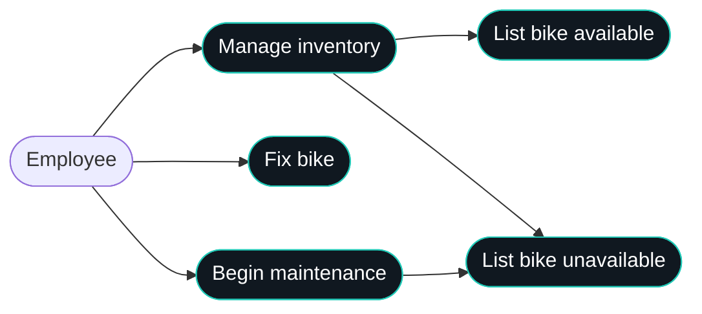
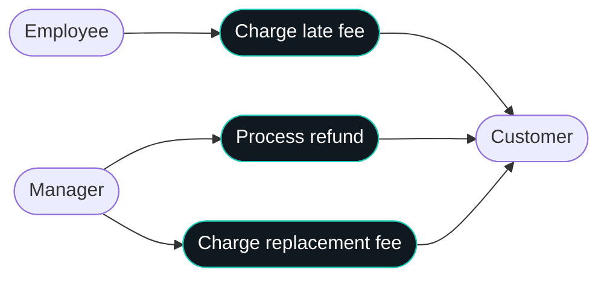
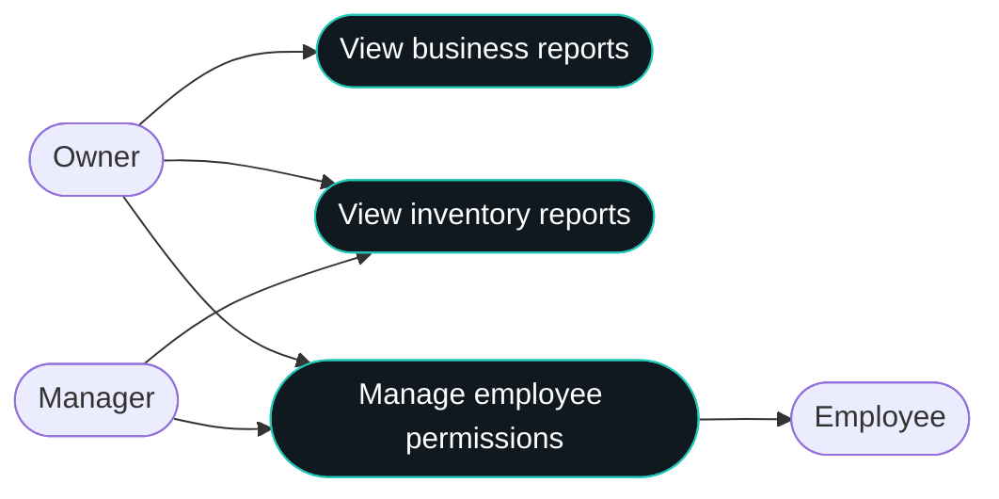
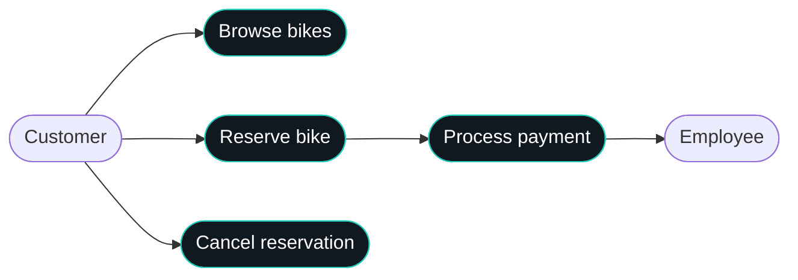
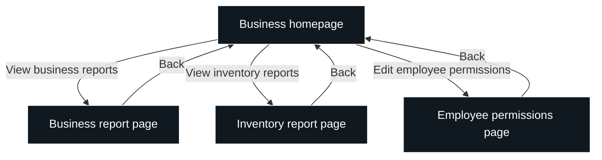
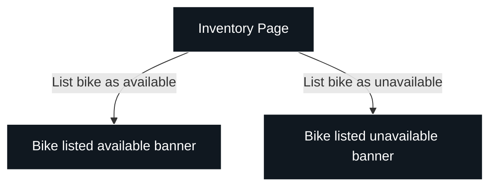
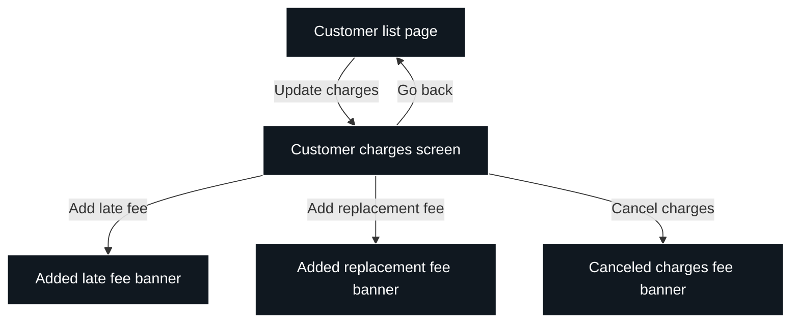

## Overview
This software for Bend Bike Shop is intended to create an easy way for the bike shop to rent out bikes. It can be used at a kiosk or online and will also be integrated with the shop to ensure accurate inventory and similar features.

The system consists of a customer-facing rental interface and an employee-facing management interface. Both interfaces use a shared backend and database so that reservations, inventory availability, payments, and customer charges remain consistent across platforms.

## Actors
- **Customer:** Browses bikes, creates reservations, processes payments, and cancels reservations.
- **Employee:** Manages inventory, handles maintenance, and applies late fees.
- **Manager:** Performs employee management tasks, views inventory reports, processes refunds, and applies replacement fees.
- **Owner:** Views business and inventory reports and manages employee permissions.

## Goals/Non-Goals
* Automated system to cancel rentals for unforeseen closure days
* Tracking for helmets
* Require an account
* Automated replacement charge for missing rentals
* Selling bikes through the system. Website is only for rentals
* No extending rentals via the website. You must talk to an employee

## Constraints
* Bikes are handled during business hours
* Payment must be verified and valid
* Customers can reserve bikes as guests without creating an account
* Customers can reserve bikes up to 6 months in advance
* Managers can edit/remove employee permissions

## Assumptions
* Initial inventory is accurate and future audits remain accurate.
* Internet is provided reliably.
* Employees will update bikes to be unavailable for maintenance.
* Employees will have sufficient training on the application.
* The payment provider and store payment terminals expose the functionality required to verify and process payments.
* The shared database is the authoritative source for reservations, bike availability, and customer charges.

## Non-Functional Requirements
* The cloud-hosted platform must have an uptime of 99.5% or higher.
* The system should be able to support the inventory of the 60 or so bikes that are owned by Bend Bike Shop.
* The website should be fully compatible with the following browsers: Firefox, Chrome, Edge, Safari.
* Payment terminals at the store should be reputable and securely store credit card info. Card data should be handled by the payment provider rather than stored directly in the application database.
* Customers should not be able to access the employee portal.
* Data must be identical and synced across all platforms and portals. All interfaces should read and update the shared backend rather than maintain separate copies of business data.

## System Architecture

The system uses a client-server architecture with a shared cloud backend.

| Component | Responsibility |
|---|---|
| Customer interface | Displays rental options, availability, reservation details, and payment status. |
| Employee interface | Provides inventory management, customer charge management, and administrative pages. |
| Backend/API | Validates requests, enforces permissions, applies business rules, and coordinates database and payment operations. |
| Database | Stores bikes, reservations, customer records, charges, employee accounts, and permissions. |
| Payment provider | Processes payment authorization, charges, and refunds without exposing sensitive payment data to the application. |

Customer and employee interfaces communicate with the backend through API requests over HTTPS. The backend validates each request before reading or changing persistent data. Successful changes are saved to the database and returned to the requesting interface.

The database acts as the source of truth. Other interfaces retrieve updated data from the backend instead of independently maintaining inventory or reservation records.

## Data Design

The following entities represent the core application data.

| Entity | Important fields | Purpose |
|---|---|---|
| Bike | bike_id, bike_type, status | Identifies each bicycle and its current availability or maintenance status. |
| Reservation | reservation_id, customer_id, start_date, end_date, status, total_amount | Records the rental period, customer association, and reservation state. |
| Customer | customer_id, name, contact_information | Stores customer details when available. Guest reservations are supported. |
| Payment | payment_id, reservation_id, amount, provider_reference, status | Tracks payment attempts and their outcomes. |
| Charge | charge_id, customer_id, reservation_id, amount, charge_type, status | Records late fees, replacement fees, and charge cancellations. |
| Employee | employee_id, name, account_reference, role | Identifies staff members and their assigned roles. |
| Permission | permission_id, employee_id, permission_type | Defines the employee access permissions managed by authorized staff. |

Primary keys uniquely identify records. Foreign keys associate reservations with customers, payments with reservations, charges with customers and reservations, and permissions with employees. Guest reservations may omit a registered customer association while retaining the contact information needed to manage the reservation.

Reservation and payment status should be stored explicitly rather than inferred from the presence or absence of related records. Charge cancellations should preserve the original charge record and its updated status for reporting and auditing.

## Core Processing

### Reservations and Payments
1. The customer selects a bike type and rental period.
2. The backend checks inventory availability for the requested period.
3. The customer submits reservation details and payment information.
4. The backend validates the request and coordinates payment processing with the payment provider.
5. The reservation is confirmed only after the required availability and payment checks succeed.
6. The resulting reservation and payment statuses are saved and returned to the customer interface.

Availability checks and reservation creation must be coordinated to prevent overlapping reservations for the same bicycle. If payment fails, the system must not present the reservation as successfully paid.

### Inventory Management
1. An employee opens the inventory page and selects a bicycle.
2. The employee marks the bicycle as available or unavailable.
3. The backend validates the employee's permissions and the requested status change.
4. The database is updated and the interface displays a confirmation.
5. Subsequent availability queries use the updated inventory status.

Bicycles undergoing maintenance must not be offered for conflicting rental periods. Inventory status changes must also be considered when determining whether an existing reservation can be fulfilled.

### Customer Charges
1. An authorized employee opens a customer's charge records.
2. The employee selects a late fee, replacement fee, or charge cancellation action.
3. The backend verifies permissions and validates the amount and associated records.
4. The charge is recorded or updated, and the interface displays the result.
5. Refunds are processed through the payment provider, with the outcome recorded in the system.

Charge records should retain their association with the relevant customer and reservation so they can be used in customer histories and business reports.

### Employee Permissions
1. An authorized manager or owner opens the employee permissions page.
2. The selected employee's current permissions are retrieved from the backend.
3. The authorized user changes the permitted access levels.
4. The backend verifies the user's authority and saves the changes.
5. Subsequent requests use the updated permissions.

Authorization must be enforced by the backend, not only by hiding controls in the interface.

### Reports
Business and inventory reports retrieve their data from the shared database. Business reports use reservation, payment, and charge records to summarize rental activity and financial performance. Inventory reports use bicycle status and reservation records to summarize inventory and availability.

Reports should use consistent definitions for reservation statuses, rental periods, and charge outcomes so totals remain consistent across report pages.

## Use Case Diagrams
| Cell | Short description |
|---|---|
| Employee | Staff member who manages inventory and handles bike maintenance. |
| Manage inventory | Manage bicycle availability and inventory status. |
| Fix bike | Repair a bicycle that needs maintenance. |
| Begin maintenance | Mark a bicycle as undergoing maintenance. |
| List bike available | Mark a bicycle as available for rental. |
| List bike unavailable | Mark a bicycle as unavailable for rental. |
| Manager | Staff member with permissions for refunds, replacement fees, and administrative tasks. |
| Charge late fee | Apply a fee when a customer returns a bike late. |
| Process refund | Issue a refund to a customer. |
| Charge replacement fee | Charge a customer for a missing or replacement bicycle. |
| Customer | Person who rents or reserves bicycles. |
| Owner | Business owner with access to reports and employee permissions. |
| Cancel all reservations today | Cancel all reservations scheduled for the current day. |
| Cancel reservation | Cancel an individual bike reservation. |
| View business reports | View reports about business performance and rental activity. |
| View inventory reports | View reports about bicycle inventory and availability. |
| Manage employee permissions | Manage employee access levels and permissions. |
| Browse bikes | View available bicycle types and rental options. |
| Reserve bike | Reserve a bicycle for a selected date and rental period. |
| Process payment | Process payment authorization and rental charges. |

## UX Diagrams
| Cell | Short description |
|---|---|
| Business homepage | Main navigation page for business management features. |
| Business report page | Display business performance and rental reports. |
| Inventory report page | Display inventory statistics and bicycle availability reports. |
| Employee permissions page | View and edit employee access permissions. |
| Inventory Page | Interface for managing bicycle inventory and availability. |
| Bike listed available banner | Confirmation that a bicycle has been marked available. |
| Bike listed unavailable banner | Confirmation that a bicycle has been marked unavailable. |
| Customer list page | Display customers and provide access to their records. |
| Customer charges screen | View and update charges associated with a customer. |
| Added late fee banner | Confirmation that a late fee has been added. |
| Added replacement fee banner | Confirmation that a replacement fee has been added. |
| Canceled charges fee banner | Confirmation that charges have been canceled. |
| View business reports | Navigate from the homepage to business reports. |
| View inventory reports | Navigate from the homepage to inventory reports. |
| Edit employee permissions | Navigate to the employee permissions page. |
| Back | Return to the business homepage or previous page. |
| List bike as available | Mark a bicycle as available and display confirmation. |
| List bike as unavailable | Mark a bicycle as unavailable and display confirmation. |
| Update charges | Open the customer charges screen to manage fees. |
| Go back | Return from the customer charges screen to the customer list. |
| Add late fee | Add a late fee to a customer's charges. |
| Add replacement fee | Add a replacement fee to a customer's charges. |
| Cancel charges | Cancel charges and display a confirmation message. |

The employee interface should use a shared navigation layout for management pages. Each page retrieves the data it needs from the backend and submits changes through validated requests. Success and failure messages should reflect the actual result returned by the backend.

The customer interface should display bike availability, reservation details, and payment status using the same backend data. Employee-only pages and operations must require authorization.

