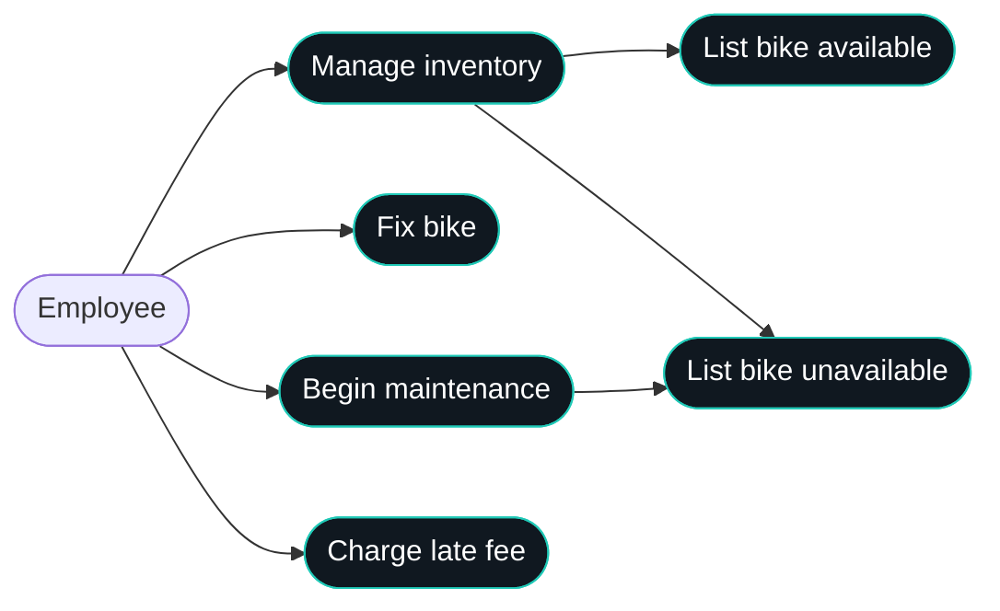
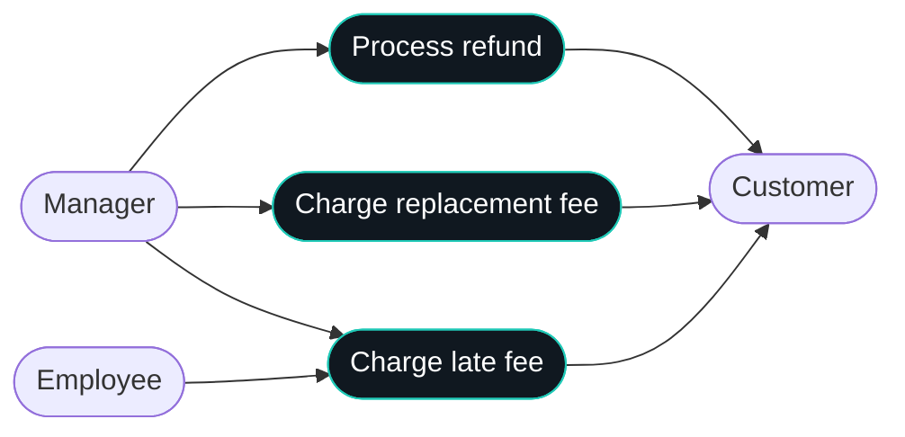
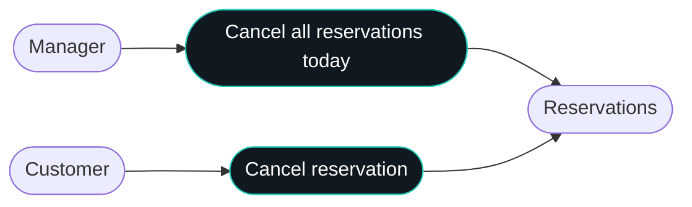
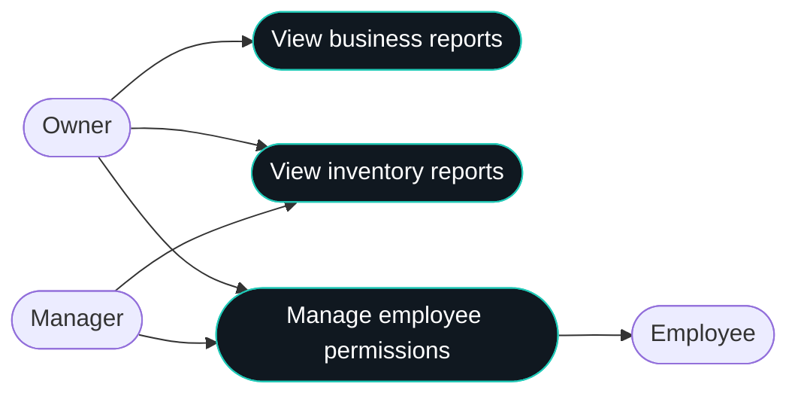
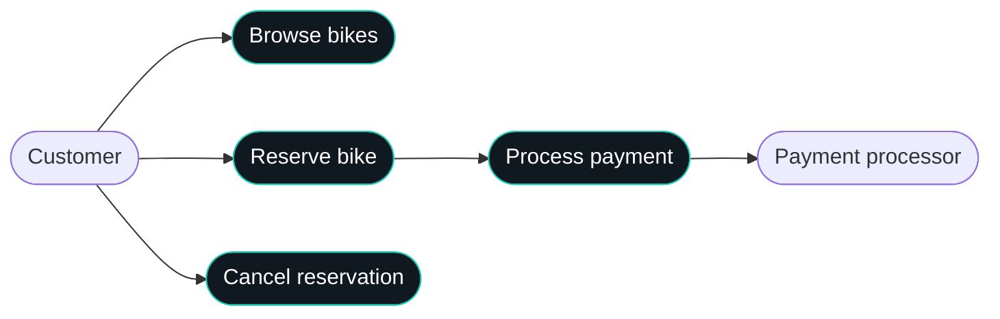
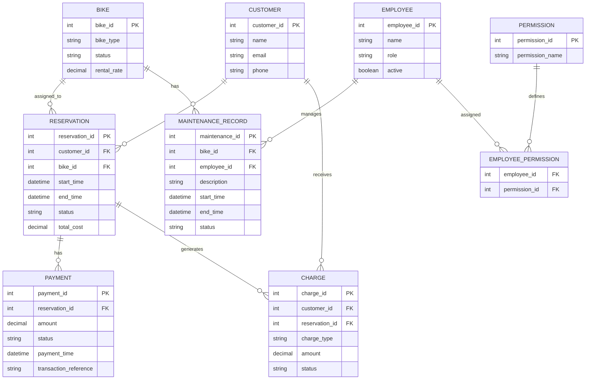
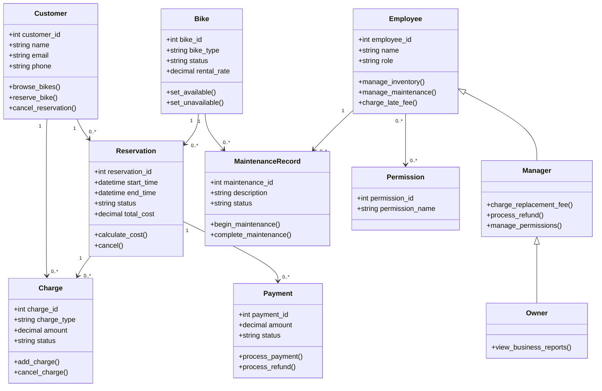
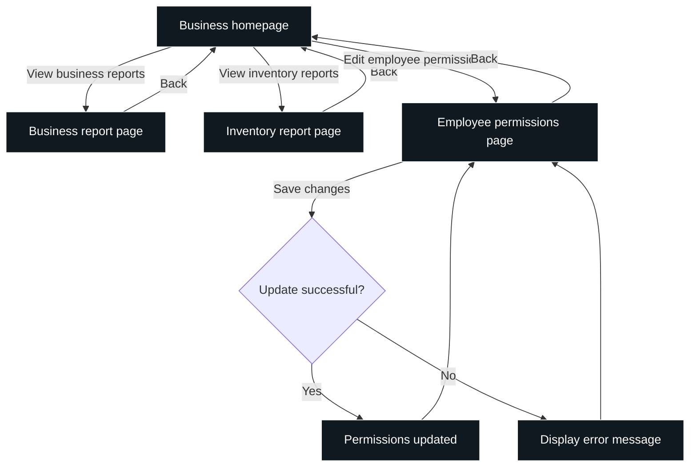
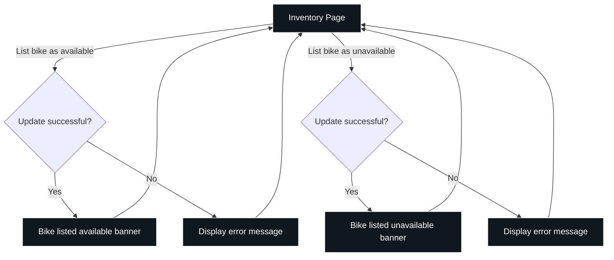
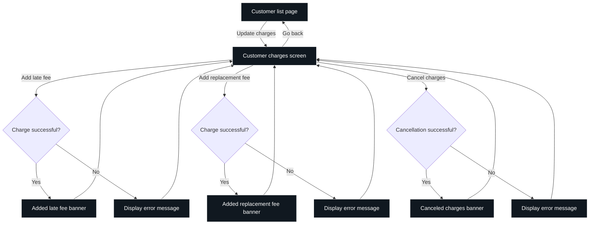

**## Overview**

This software for Bend Bike Shop is intended to create an easy way for the bike shop to rent out bikes. It can be used at a kiosk or online and will also be integrated with the shop to ensure accurate inventory and similar features.

**## Actors**

Customer, Manager, Owner, Employee

**## Goals/Non-Goals**

* Automated system to cancel rentals for unforeseen closure days
* Tracking for helmets
* Require an account
* Automated replacement charge for missing rentals
* Selling bikes through the system. Website is only for rentals
* No extending rentals via the website. You must talk to an employee

**## Constraints**

* Bikes are handled during business hours
* Payment must be verified and valid
* Customers can reserve bikes as guests without creating an account
* Customers can reserve bikes up to 6 months in advance
* Managers can edit/remove employee permissions

**## Assumptions**

* Initial inventory is accurate and future audits remain accurate
* Internet is provided reliably
* Employees will update bikes to be unavailable for maintenance
* Employees will have sufficient training on the application

**## Non-Functional Requirements**

* The cloud-hosted platform must have an uptime of 99.5% or higher.
* The system must support the current inventory of approximately 60 bikes.
* The website must support the latest stable versions of Firefox, Chrome, Edge, and Safari.
* Payment terminals must use a PCI-compliant payment processor. The application must not store raw credit card information.
* Customers must not be able to access employee portal pages or administrative functions.
* The database must act as the authoritative source for reservation and inventory information.
* Inventory and reservation changes must synchronize across the website, kiosk, and employee portal within 5 seconds under normal network conditions.
* Failed synchronization attempts must be logged and automatically retried.
* Employee and administrative actions must be validated against assigned permissions on the server, not just the user interface.

**## Use Case Diagrams**

| Cell | Short description |
|---|---|
| Employee | Staff member who manages inventory and handles bike maintenance. |
| Manage inventory | Manage bicycle availability and inventory status. |
| Fix bike | Repair a bicycle that needs maintenance. |
| Begin maintenance | Mark a bicycle as undergoing maintenance. |
| List bike available | Mark a bicycle as available for rental. |
| List bike unavailable | Mark a bicycle as unavailable for rental. |
| Manager | Staff member with permissions for refunds, replacement fees, and administrative tasks. |
| Charge late fee | Apply a fee when a customer returns a bike late. |
| Process refund | Issue a refund to a customer. |
| Charge replacement fee | Charge a customer for a missing or replacement bicycle. |
| Customer | Person who rents or reserves bicycles. |
| Owner | Business owner with access to reports and employee permissions. |
| Cancel all reservations today | Cancel all reservations scheduled for the current day. |
| Cancel reservation | Cancel an individual bike reservation. |
| View business reports | View reports about business performance and rental activity. |
| View inventory reports | View reports about bicycle inventory and availability. |
| Manage employee permissions | Manage employee access levels and permissions. |
| Browse bikes | View available bicycle types and rental options. |
| Reserve bike | Reserve a bicycle for a selected date and rental period. |
| Process payment | Process payment authorization and rental charges. |

**Role permissions:** Managers inherit standard employee capabilities and can perform administrative tasks, including refunds, replacement fees, and permission management. Owners inherit manager capabilities and additionally have access to business reports. Employees can manage inventory, maintenance, and late fees.











**## Data Model**

**### ER Diagram**

The database uses reservations to connect customers, bikes, and payments. Each reservation is associated with one bike. This keeps individual bike availability and scheduling straightforward. Payments and additional charges are tracked separately to maintain accurate financial records.



**Data model details:**

* Customer records contain contact information. Guest reservations do not require a permanent customer account.
* Bike status determines whether a bike is available, reserved, or undergoing maintenance.
* Reservations store rental dates, assigned bikes, customer information, and total cost.
* Payments store transaction references and payment statuses without storing raw credit card information.
* Charges track additional fees, including late and replacement fees.
* Maintenance records track the employee responsible, repair description, and maintenance status.
* Employee permissions are stored separately from employee records to support multiple permissions per employee.

**### Class Diagram**

The class model separates business responsibilities. Reservation handles rental calculations and cancellation, Payment handles transactions, and Charge handles additional fees. Managers inherit employee functionality, while owners inherit manager functionality.



**Class responsibilities:**

* **Customer:** Browses bikes, creates reservations, and cancels reservations.
* **Bike:** Stores bicycle information and controls availability.
* **Reservation:** Stores rental information, calculates costs, and manages reservation status.
* **Payment:** Communicates with the payment processor and tracks payment/refund results.
* **Charge:** Creates and cancels additional customer charges.
* **Employee:** Manages inventory, maintenance, and late fees.
* **Manager:** Extends employee capabilities with refunds, replacement fees, and permission management.
* **Owner:** Extends manager capabilities with access to business reports.
* **MaintenanceRecord:** Tracks repair activity and maintenance status.
* **Permission:** Defines available employee access permissions.

**## Interfaces**

The following interfaces define the primary operations between the user interface, business logic, and database. Functions return structured results or raise appropriate errors when an operation cannot be completed.

```python
def browse_bikes(
    start_time: datetime,
    end_time: datetime,
    bike_type: str | None = None
) -> list[Bike]:
    # - Purpose: Display available bikes for rent.
    # - Requires: Valid rental period with start_time before end_time.
    # - Outcomes: Returns bikes matching the requested type and availability.
    # - Guarantees: Read-only operation; does not modify inventory.
    # - Notes: Bikes undergoing maintenance are excluded from available results.
```

```python
def reserve_bike(
    customer_info: CustomerInfo,
    bike_id: int,
    start_time: datetime,
    end_time: datetime,
    payment_info: PaymentInfo
) -> Reservation:
    # - Purpose: Create a reservation and process the required payment.
    # - Requires: Valid customer information, rental period, available bike, and payment information.
    # - Outcomes: Creates a confirmed reservation if payment succeeds.
    # - Guarantees: Prevents overlapping confirmed reservations. Failed payments cannot create confirmed reservations.
    # - Notes: Supports guest reservations and bookings up to six months in advance.
```

```python
def cancel_reservation(
    reservation_id: int,
    requester_id: int | None = None
) -> bool:
    # - Purpose: Cancel an existing reservation.
    # - Requires: Reservation exists and requester is authorized.
    # - Outcomes: Updates reservation status and releases the bike for the applicable rental period.
    # - Guarantees: Prevents duplicate refunds and changes to unrelated reservations.
    # - Notes: Refund eligibility depends on the cancellation policy. Failed refunds must remain recorded for retry.
```

```python
def update_bike_availability(
    bike_id: int,
    available: bool,
    employee_id: int
) -> bool:
    # - Purpose: Update a bike's rental availability.
    # - Requires: Bike exists and employee has inventory permissions.
    # - Outcomes: Updates bike availability across the website, kiosk, and employee portal.
    # - Guarantees: Bikes undergoing maintenance cannot be marked available. Existing reservations cannot be silently invalidated.
    # - Notes: A completed maintenance record is required before returning a bike to service.
```

```python
def add_customer_charge(
    customer_id: int,
    reservation_id: int,
    charge_type: ChargeType,
    amount: Decimal,
    employee_id: int
) -> Charge:
    # - Purpose: Add a late fee or replacement fee to a customer's charges.
    # - Requires: Customer and reservation exist, amount is valid, and employee has required permissions.
    # - Outcomes: Creates a charge associated with the customer and reservation.
    # - Guarantees: Charge type must be valid and amount must be nonnegative. Duplicate charges are prevented.
    # - Notes: Replacement fees require manager permissions. Late fees may be processed by employees.
```

```python
def manage_employee_permissions(
    manager_id: int,
    employee_id: int,
    permissions: list[Permission]
) -> bool:
    # - Purpose: Update an employee's system permissions.
    # - Requires: Manager has permission to manage employee access and employee exists.
    # - Outcomes: Saves the employee's updated permissions.
    # - Guarantees: Unauthorized users cannot modify permissions. Previous permissions remain if the update fails.
    # - Notes: Permission changes must be recorded for auditing.
```

**## Invariants**

**Reservation availability:** A bike cannot have overlapping confirmed reservations. Bikes marked unavailable or undergoing maintenance cannot be reserved for the affected period.

**Payment integrity:** A reservation cannot be confirmed until its required payment is successfully verified. Failed payments must not produce confirmed reservations or duplicate charges.

**Inventory consistency:** Bike availability and reservation status must remain consistent across the website, kiosk, and employee portal. A bike cannot be marked available while it is undergoing maintenance.

**Access control:** Employees may only perform actions permitted by their assigned permissions. Managers inherit employee permissions and can perform administrative operations. Owners inherit manager permissions and have additional access to business reports.

**Reservation integrity:** Every reservation must reference an existing customer and bike. Rental end times must be later than start times. Canceled reservations cannot remain active in availability calculations.

**Financial integrity:** Payments and charges must reference valid reservations. Refunds cannot exceed the original payment amount. All financial transactions must retain their original transaction records for auditing.

**Maintenance integrity:** Every maintenance record must reference an existing bike and employee. A bike cannot return to available status until its maintenance is completed.

**## Failure Modes**

| ID | Failure | Detection | Response | Impact | Notification |
|---|---|---|---|---|---|
| F1 | Payment authorization fails | Payment processor returns a failure or timeout. | Do not confirm the reservation; allow the customer to retry payment. | Customer cannot complete the reservation. | Display an error message to the customer. |
| F2 | Two customers attempt to reserve the same bike for overlapping periods | Reservation validation detects an existing conflicting reservation. | Reject the conflicting reservation and refresh availability. | One customer must select another bike or rental period. | Notify the customer that the bike is no longer available. |
| F3 | Website, kiosk, and employee portal become out of sync | Synchronization checks detect inconsistent inventory or reservation data. | Reconcile data against the authoritative database and retry synchronization. | Customers may see incorrect availability until synchronization completes. | Log the error and notify administrators if synchronization cannot recover. |
| F4 | Database or network becomes unavailable | Connection errors, failed requests, or health checks. | Reject operations requiring unavailable data. Retry transient failures without duplicating transactions. | Reservations, payments, and inventory updates may be temporarily unavailable. | Display a temporary service error and alert administrators when appropriate. |
| F5 | Employee attempts an unauthorized operation | Permission validation rejects the request. | Deny the operation and record the access attempt. | Employee cannot complete the restricted task. | Display an access-denied message and log the event. |
| F6 | Bike becomes unavailable after a reservation is made | Employee reports damage or maintenance requirements for a reserved bike. | Mark the bike unavailable, identify affected reservations, and have staff resolve conflicts. | Affected reservations may require reassignment or cancellation. | Notify employees and contact affected customers. |
| F7 | Duplicate payment or charge request occurs | Transaction identifiers or existing records indicate a duplicate operation. | Reject the duplicate or return the result of the original operation. | Potential incorrect customer charges if not prevented. | Log the duplicate attempt and notify staff if manual review is required. |
| F8 | Reservation cancellation or refund fails | Cancellation or payment processor returns an error. | Preserve the existing transaction status, record the failure, and allow a safe retry. | Reservation status or customer refund may remain unresolved. | Display the failure and alert staff when manual intervention is required. |
| F9 | Employee permissions cannot be updated | Database update fails or saved permissions do not match requested permissions. | Retain previous permissions and retry the update. | Employee access may not reflect intended changes. | Notify the manager and log the failure. |
| F10 | System becomes unavailable during a business closure | Automated cancellation process fails or cannot access reservation data. | Retry the operation and provide an administrative recovery process. | Customers may retain reservations for a day the shop is closed. | Alert management and provide a list of reservations requiring attention. |
| F11 | Maintenance update fails | Database rejects the maintenance status change or the update times out. | Retain the previous recorded status and retry. Do not mark the bike available until the update succeeds. | Bike availability may be temporarily inaccurate. | Display an error to the employee and log the failed update. |
| F12 | Report data cannot be retrieved | Database query fails or required records are unavailable. | Display an error and allow the report to be refreshed. Do not display incomplete data as a complete report. | Managers and owners cannot view accurate reports temporarily. | Display a report loading error and log the issue. |

**## UX Diagrams**

| Cell | Short description |
|---|---|
| Business homepage | Main navigation page for business management features. |
| Business report page | Display business performance and rental reports. |
| Inventory report page | Display inventory statistics and bicycle availability reports. |
| Employee permissions page | View and edit employee access permissions. |
| Inventory Page | Interface for managing bicycle inventory and availability. |
| Bike listed available banner | Confirmation that a bicycle has been marked available. |
| Bike listed unavailable banner | Confirmation that a bicycle has been marked unavailable. |
| Customer list page | Display customers and provide access to their records. |
| Customer charges screen | View and update charges associated with a customer. |
| Added late fee banner | Confirmation that a late fee has been added. |
| Added replacement fee banner | Confirmation that a replacement fee has been added. |
| Canceled charges banner | Confirmation that charges have been canceled. |
| Error banner | Display an error when an operation fails. |
| View business reports | Navigate from the homepage to business reports. |
| View inventory reports | Navigate from the homepage to inventory reports. |
| Edit employee permissions | Navigate to the employee permissions page. |
| Back | Return to the business homepage or previous page. |
| List bike as available | Mark a bicycle as available and display confirmation. |
| List bike as unavailable | Mark a bicycle as unavailable and display confirmation. |
| Update charges | Open the customer charges screen to manage fees. |
| Go back | Return from the customer charges screen to the customer list. |
| Add late fee | Add a late fee to a customer's charges. |
| Add replacement fee | Add a replacement fee to a customer's charges. |
| Cancel charges | Cancel charges and display a confirmation message. |

**UX behavior:**

* Successful operations display a confirmation banner and update the relevant page.
* Failed operations display an error banner explaining why the action could not be completed.
* Form validation errors should identify the field that needs correction.
* Failed database or network operations should preserve the user's entered information when possible.
* Permission errors should prevent the action and return the user to an authorized page.
* Destructive actions, such as canceling reservations or charges, should require confirmation before execution.





