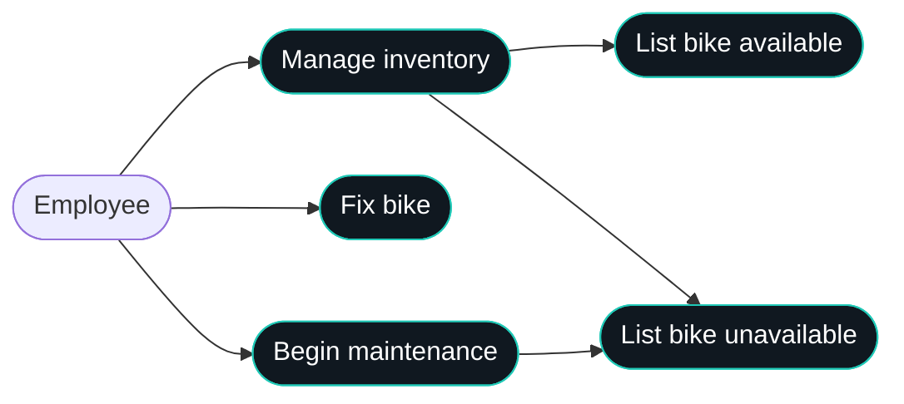
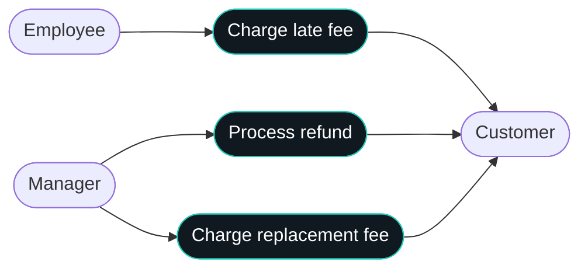
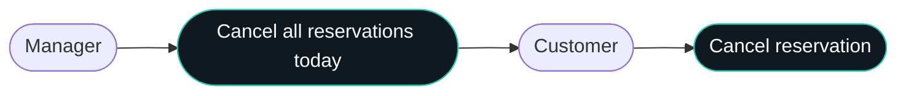
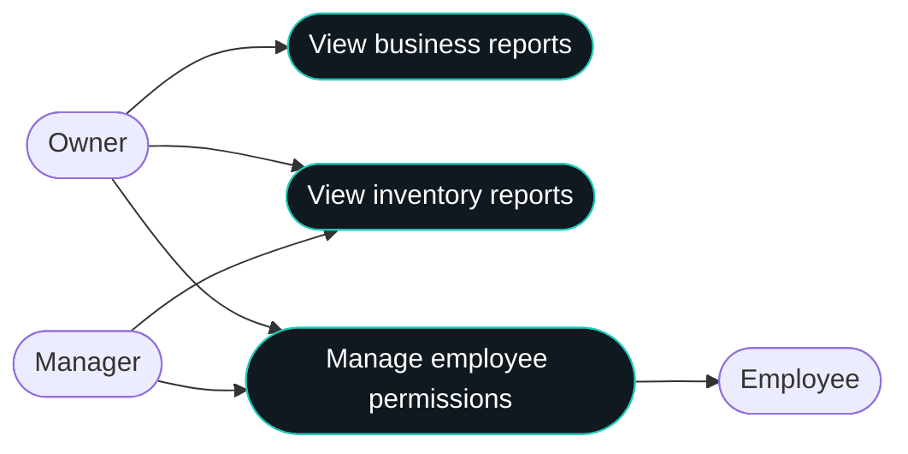
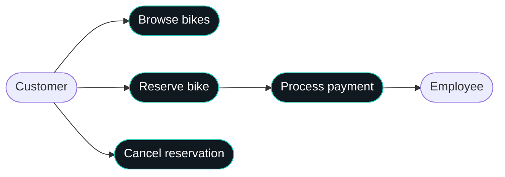
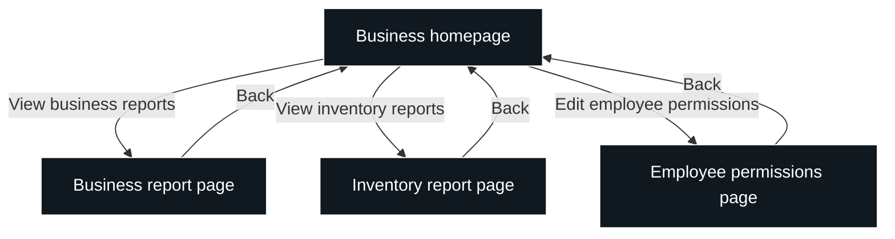
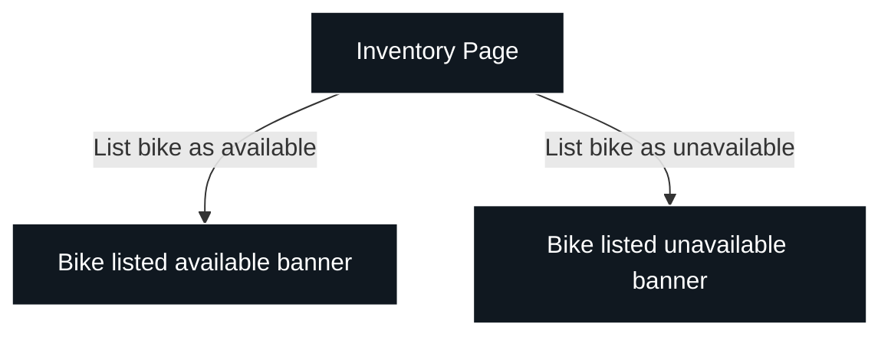
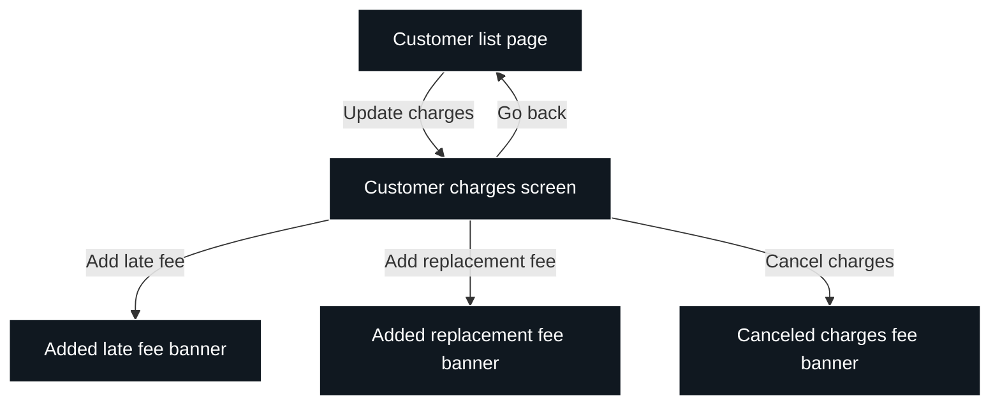

## Overview
This software for Bend Bike Shop is intended to create an easy way for the bike shop to rent out bikes. It can be used at a kiosk or online and will also be integrated with the shop to ensure accurate inventory and similar features.
## Actors
Customer, Manager, Owner, Employee
## Goals/Non-Goals
* Automated system to cancel rentals for unforeseen closure days
* Tracking for helmets
* Require an account
* Automated replacement charge for missing rentals
* Selling bikes through the system. Website is only for rentals
* No extending rentals via the website. You must talk to an employee
## Constraints
* Bikes are handled during business hours
* Payment must be verified and valid
* Customers can reserve bikes as guests without creating an account
* Customers can reserve bikes up to 6 months in advance
* Managers can edit/remove employee permissions
## Assumptions
* initial inventory is accurate and future audits remain accurate
* internet is provided reliably
* Employees will update bikes to be unavailable for maintenance
* Employees will have sufficient training on the application
## Non-Functional Requirements
* The cloud hosted platform must have an uptime of 99.5% or higher
* The system should be able to support the inventory of the 60 or so bikes that are owned by Bend Bike Shop
* The website should be fully compatible with the following browsers: Firefox, Chrome, Edge, Safari
* Payment terminals at the store should be reputable and securely store credit card info
* Customers should not be able to access employee portal
* Data must be identical and synced across all platforms and portals
## Use Case Diagrams
| Cell | Short description |
|---|---|
| Employee | Staff member who manages inventory and handles bike maintenance. |
| Manage inventory | Manage bicycle availability and inventory status. |
| Fix bike | Repair a bicycle that needs maintenance. |
| Begin maintenance | Mark a bicycle as undergoing maintenance. |
| List bike available | Mark a bicycle as available for rental. |
| List bike unavailable | Mark a bicycle as unavailable for rental. |
| Manager | Staff member with permissions for refunds, replacement fees, and administrative tasks. |
| Charge late fee | Apply a fee when a customer returns a bike late. |
| Process refund | Issue a refund to a customer. |
| Charge replacement fee | Charge a customer for a missing or replacement bicycle. |
| Customer | Person who rents or reserves bicycles. |
| Owner | Business owner with access to reports and employee permissions. |
| Cancel all reservations today | Cancel all reservations scheduled for the current day. |
| Cancel reservation | Cancel an individual bike reservation. |
| View business reports | View reports about business performance and rental activity. |
| View inventory reports | View reports about bicycle inventory and availability. |
| Manage employee permissions | Manage employee access levels and permissions. |
| Browse bikes | View available bicycle types and rental options. |
| Reserve bike | Reserve a bicycle for a selected date and rental period. |
| Process payment | Process payment authorization and rental charges. |

## UX Diagrams
| Cell | Short description |
|---|---|
| Business homepage | Main navigation page for business management features. |
| Business report page | Display business performance and rental reports. |
| Inventory report page | Display inventory statistics and bicycle availability reports. |
| Employee permissions page | View and edit employee access permissions. |
| Inventory Page | Interface for managing bicycle inventory and availability. |
| Bike listed available banner | Confirmation that a bicycle has been marked available. |
| Bike listed unavailable banner | Confirmation that a bicycle has been marked unavailable. |
| Customer list page | Display customers and provide access to their records. |
| Customer charges screen | View and update charges associated with a customer. |
| Added late fee banner | Confirmation that a late fee has been added. |
| Added replacement fee banner | Confirmation that a replacement fee has been added. |
| Canceled charges fee banner | Confirmation that charges have been canceled. |
| View business reports | Navigate from the homepage to business reports. |
| View inventory reports | Navigate from the homepage to inventory reports. |
| Edit employee permissions | Navigate to the employee permissions page. |
| Back | Return to the business homepage or previous page. |
| List bike as available | Mark a bicycle as available and display confirmation. |
| List bike as unavailable | Mark a bicycle as unavailable and display confirmation. |
| Update charges | Open the customer charges screen to manage fees. |
| Go back | Return from the customer charges screen to the customer list. |
| Add late fee | Add a late fee to a customer's charges. |
| Add replacement fee | Add a replacement fee to a customer's charges. |
| Cancel charges | Cancel charges and display a confirmation message. |

