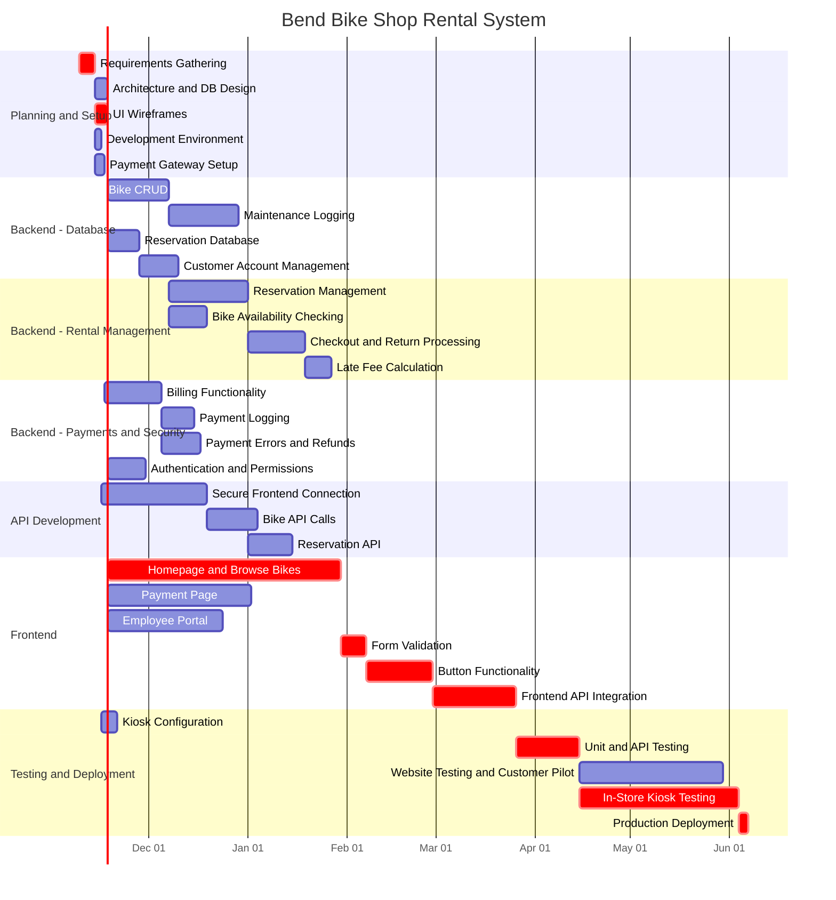

# Bend Bike Shop Rental System
> [!NOTE] (O, M, P) in hours
  - **Planning and Setup (Supporting Tasks)**
    - Requirements gathering and acceptance criteria (5 days)
    - System architecture and database schema design (4 days)
    - Frontend wireframes and UI design (4 days)
    - Development environment, repository, and CI setup (2 days)
    - Payment gateway setup and credentials (3 days)

  - **Frontend (40%)**
    - UI (30%)
      - Homepage / browse bikes (10%)
        - (45, 64, 90) P90: 72.70 days
      - Payment page (10%)
        - (30, 42, 50) P90: 44.70 days
      - Employee portal (10%)
        - (20, 34, 40) P90: 35.89 days
      - Form validation and error messages
        - Estimated: 8 days
    - Connection to Backend (10%)
      - APIs to backend (5%)
        - (16, 24, 30) P90: 26.03 days
      - Button press functionality (5%)
        - (15, 20, 24) P90: 21.37 days

  - **Backend (50%)**
    - Bike Database (15%)
      - Bike entry/update/delete system (10%)
        - (16, 18, 20) P90: 18.68 days
      - Maintenance logging (5%)
        - (10, 19, 28) P90: 22.08 days
      - Reservation database
        - Estimated: 10 days
      - Customer account management
        - Estimated: 12 days

    - **Payment Handling (15%)**
      - Billing functionality (10%)
        - (5, 15, 24) P90: 18.09 days
      - Payment logging (5%)
        - (5, 8, 15) P90: 10.20 days
      - Payment error handling
        - Estimated: 12 days
      - Refund processing
        - Included in payment error handling estimate

    - **API Functionality (20%)**
      - Setup secure connection to frontend (10%)
        - (20, 30, 40) P90: 33.44 days
      - API calls for fetching/updating/deleting bikes (10%)
        - (8, 14, 20) P90: 16.05 days
      - User authentication and role permissions
        - Estimated: 12 days
      - Reservation API functionality
        - Estimated: 14 days

    - **Rental Management**
      - Reservation creation, modification, and cancellation
        - Estimated: 25 days
      - Bike availability and conflict checking
        - Estimated: 12 days
      - Rental checkout and return processing
        - Estimated: 18 days
      - Late fee calculation
        - Estimated: 8 days

  - **Testing and Deployment (10%)**
    - Unit and API testing
      - Estimated: 20 days
    - Kiosk deployment and device configuration
      - Estimated: 5 days
    - Test with website and introduce to customers (5%)
      - (30, 40, 55) P90: 44.97 days
    - Test with kiosk in store (5%)
      - (30, 45, 60) P90: 50.14 days
    - Production deployment and final verification
      - Estimated: 3 days

>[!NOTE] Red shows the critical path

| ID | Task | Duration | Predecessor(s) | ES | EF | LS | LF | Slack |
|---|---|---:|---|---:|---:|---:|---:|---:|
| a | Requirements Gathering | 5 | - | 0 | 5 | 0 | 5 | 0 |
| b | Architecture and DB Design | 4 | a | 5 | 9 | 46 | 50 | 41 |
| c | UI Wireframes | 4 | a | 5 | 9 | 5 | 9 | 0 |
| d | Development Environment | 2 | a | 5 | 7 | 62 | 64 | 57 |
| e | Payment Gateway Setup | 3 | a | 5 | 8 | 94 | 97 | 89 |
| f | Bike CRUD | 19 | b, d | 9 | 28 | 76 | 95 | 67 |
| g | Maintenance Logging | 22 | f | 28 | 50 | 115 | 137 | 87 |
| t | Reservation Database | 10 | b | 9 | 19 | 50 | 60 | 41 |
| u | Customer Account Management | 12 | t | 19 | 31 | 60 | 72 | 41 |
| v | Reservation Management | 25 | t, u | 31 | 56 | 72 | 97 | 41 |
| w | Bike Availability Checking | 12 | f, t | 28 | 40 | 99 | 111 | 71 |
| x | Checkout and Return Processing | 18 | v, w | 56 | 74 | 111 | 129 | 55 |
| y | Late Fee Calculation | 8 | x | 74 | 82 | 129 | 137 | 55 |
| h | Billing Functionality | 18 | d, e | 8 | 26 | 97 | 115 | 89 |
| i | Payment Logging | 10 | h | 26 | 36 | 115 | 125 | 89 |
| z | Payment Errors and Refunds | 12 | h, i | 36 | 48 | 125 | 137 | 89 |
| auth | Authentication and Permissions | 12 | d | 7 | 19 | 125 | 137 | 118 |
| j | Secure Frontend Connection | 33 | d | 7 | 40 | 64 | 97 | 57 |
| k | Bike API Calls | 16 | f | 28 | 44 | 95 | 111 | 67 |
| apires | Reservation API | 14 | v, j | 56 | 70 | 97 | 111 | 41 |
| l | Homepage and Browse Bikes | 73 | c | 9 | 82 | 9 | 82 | 0 |
| m | Payment Page | 45 | c | 9 | 54 | 37 | 82 | 28 |
| n | Employee Portal | 36 | c | 9 | 45 | 46 | 82 | 37 |
| fv | Form Validation | 8 | l, m, n | 82 | 90 | 82 | 90 | 0 |
| o | Button Functionality | 21 | fv | 90 | 111 | 90 | 111 | 0 |
| p | Frontend API Integration | 26 | j, k, o, apires | 111 | 137 | 111 | 137 | 0 |
| q | Kiosk Configuration | 5 | d | 7 | 12 | 152 | 157 | 145 |
| ut | Unit and API Testing | 20 | p, g, i, z, y, auth, apires | 137 | 157 | 137 | 157 | 0 |
| r | Website Testing and Customer Pilot | 45 | ut | 157 | 202 | 162 | 207 | 5 |
| s | In-Store Kiosk Testing | 50 | ut, q | 157 | 207 | 157 | 207 | 0 |
| deploy | Production Deployment | 3 | r, s | 207 | 210 | 207 | 210 | 0 |
